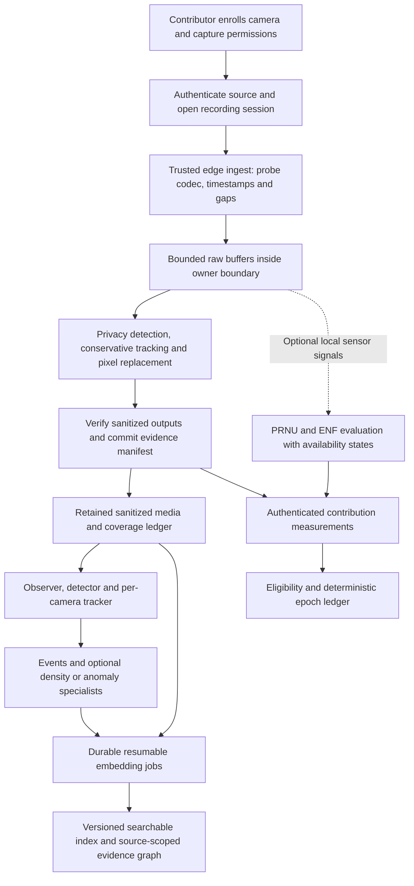
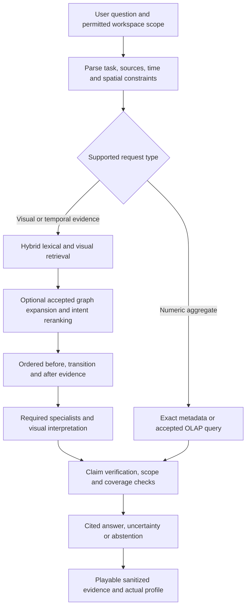

# Visn research implementation and selection plan

Date: 21 October 2026

## 1 Purpose and governing decisions

Implement a complete, general video-evidence workflow from contributor enrollment through ingestion, privacy protection, indexing, retrieval, interpretation and contribution accounting. Compare the research report's approaches with practical alternatives, then select each production component using reproducible application-level evidence.

**Finalize the architecture now; finalize experimental algorithms only after their acceptance tests.** No candidate has earned production selection through the report's published numbers or the current prototype tests. The initial choices below prioritize correctness, reuse and reversibility. Successful existing Experiments 1–3 remain the control.

This plan extends the [general video implementation plan](GENERAL_VIDEO_IMPLEMENTATION_PLAN.md) and follows the [implementation audit](DEPIN_IMPLEMENTATION_AUDIT.md). It does not replace the existing experiment runner, retained evidence, human annotations, source-scoped entity memory, persistent workers, resource scheduling or grouped-decoding work. Package6 grouped decoding remains opt-in under its documented qualification. Baseline preservation does not imply that every older capability has achieved general acceptance.

### Decisions fixed for implementation

1. Rust remains the API, job, policy and coordination layer. Existing Python workers remain the model/runtime layer. Add narrow contracts where an actual backend requires them; avoid parallel toy implementations of the same policy in Rust and Python.
2. Maintain a stable, source-scoped evidence chain. Observations, model hypotheses, reviewer labels, liveness signals and reward measurements remain distinct records.
3. Privacy runs before general analytics, durable production media and cloud transmission. Optional activity gating must never bypass it. Raw handling is confined to the source owner's trusted boundary and is not silently enabled by a fallback.
4. Preserve all permitted sanitized temporal coverage, including quiet intervals. Gate optional compute, not the existence of recorded evidence. Strict exhaustive tasks bypass lossy gate/selection candidates.
5. Keep exact full-precision retrieval as the reference and initial default. Approximate indexes, quantization, reduced evidence budgets and new numerical kernels require separate acceptance. FP32 reranking alone is not proof of exact retrieval.
6. Use a conforming H3 implementation only for known geographic coordinates. Indoor camera coordinates and geographic cells are different concepts. H3 is not necessary for a generic video question.
7. Enforce authentication, sequence/freshness and server-derived accounting before rewards. PRNU and ENF are supplementary evidence with explicit availability and uncertainty, not cryptographic truth.
8. Put every candidate behind a versioned profile and keep a tested rollback path. Never switch several unvalidated components at once.
9. Do not trade accuracy or numerical precision for resource savings. A finite evaluation can support a scoped choice; it cannot prove universal no-loss behavior.

### Deliverables that determine completion

- A working contributor-to-answer workflow through the actual application, with progress, evidence playback, uncertainty and failure states.
- An accepted baseline plus one decision record for every report proposal: selected, rejected, deferred or unsupported, with reasons and alternatives.
- Correct production contracts and regression coverage for all failures reproduced in the audit.
- Paired quality/resource results on a general held-out corpus, not only highway clips.
- Tested persistence, retries, cancellation, restart, schema migration, capacity and rollback.
- A deployment runbook with independently qualified local and Linux/NVIDIA profiles. An unavailable target remains unqualified.

## 2 Final target workflow

### 2.1 Contributor and ingest workflow

1. Enrollment assigns contributor, workspace, camera and installation identities. Record source ownership/permission, permitted collection, allowed queries, location confidence, retention and deletion policy. A public URL proves reachability, not ownership or liveness.
2. Open a new session on reconnect or clock discontinuity. Record source PTS, mapped UTC where justified, arrival monotonic time and explicit gaps. Do not invent timestamps for missing observations.
3. Detect supported codec/runtime capabilities rather than assuming H.264 motion vectors. MJPEG takes the normal decoded path. Reject malformed input with bounded errors.
4. Process raw frames in bounded memory at the trusted edge. Any raw diagnostic sample retention is a separate, explicit owner-controlled policy and never the production default. Existing immutable research masters remain untouched and excluded from production distribution.
5. Detect faces and plates, conservatively extend their masks, replace pixels, and verify output ordering. Clear/release raw buffers, intermediate crops and temporary files according to the declared boundary. Privacy failure blocks export and ordinary persistence; it records a coverage gap, not a fabricated successful interval.
6. Re-encode from sanitized pixels. Do not stream-copy raw compressed packets into a supposedly sanitized container. Strip unapproved audio, thumbnails, attachments and metadata. Audio is disabled by default until its own privacy/transcript policy is implemented.
7. Commit a hashed sanitized recording segment and its transform/provenance manifest, then expose it to workers. Mark incomplete segments and privacy failures explicitly.
8. Run existing observation/detection and source-scoped tracking. Share equivalent decoded sanitized frames within measured resource bounds. Full privacy decoding means compressed-domain motion features will not automatically eliminate privacy decode cost.
9. Persist events and enqueue durable indexing. Index quiet coverage as well as detected activity. Publish a completed index version atomically; partial indexes remain visibly partial.
10. Produce contribution measurements from committed evidence and authenticated infrastructure, not user-supplied PCE/quality/demand numbers. Settle eligible contributions through a durable epoch ledger independently of question answering.

**Cloud ingest limitation:** if a legacy camera can only send its raw feed to a remote server, that mode cannot claim raw media never leaves the premises. It needs an edge connector or an explicitly different deployment policy. Lack of edge hardware is not permission to silently weaken the boundary.

### 2.2 Question and insight workflow

Authorize scope before retrieval and enforce it again during graph traversal, reranking, cached-result loading and playback. Use timestamps and explicit supported constraints, not unrestricted model-generated SQL. Numerical counts come from defined observations/aggregates, not a VLM guessing crowd size.

Questions about arriving/leaving, placing/removing and opening/closing require ordered temporal evidence with visible initial/final states and target grounding. A graph edge supplies a retrieval lead; temporal adjacency is not proof of causation or identity. If sanitized detail, missing frames or ambiguous targets prevent verification, return that limitation and decline the unsupported claim.

OCR and ASR are optional modalities with independent provenance and availability. Exact face identification and central raw-plate search are outside the default privacy-preserving profile. Do not retain raw identifiers in captions/embeddings as a workaround for image masking. An exceptional identifier workflow requires a separate explicit policy and cannot inherit this profile's privacy claims.

## 3 Data and service contracts

Extend existing structures and storage rather than introducing a second source of truth. Freeze the following schema contracts before backend experiments:

| Record | Required fields and invariant |
| --- | --- |
| Source session | Workspace/contributor/camera/session IDs; codec; resolution; source clock mapping; authentication and transport mode; location/reference-frame confidence; discontinuity sequence. Never share tracker state across sessions. |
| Evidence segment | Stable ID; sanitized content hash; source lineage reference; actual PTS interval; retained/missing intervals; privacy policy/model/version; transformations; artifact state. No raw download URL in general responses. |
| Detection or track | Source/session/frame IDs; actual PTS; class; normalized and source-pixel geometry; detector profile; association confidence; observation versus prediction. Track IDs are not verified identity. |
| Privacy result | Detector execution status; masks and raw-detection extent; uncertainty; sanitizer version; verified output hash; dropped/export-blocked intervals. Mask metadata alone cannot mark media sanitized. |
| Event or graph edge | Evidence IDs and time range; namespace; observed relation versus inferred relation; confidence and producing profile. Cross-camera linkage stays uncertain unless independently established. |
| Embedding and index | Evidence/transform/model/processor hashes; dimension; dtype; normalization; distance metric; index version; completion state. Schema mismatch is an error, not an implicit conversion. |
| Job | Idempotency key; state; durable cursor; retry count; input fingerprints; owner; resource budget; cancellation state; output version. Commit artifacts before marking completion. |
| Trust measurement | Measuring component and signature; sequence/nonce; source session; validity interval; quality and availability; raw signal lineage restricted to trusted boundary. Keep source authenticity distinct from connector authenticity. |
| Contribution epoch | Unique epoch/camera/measurement keys; rule version; evidence range; disqualification reasons; integer monetary/point units; settlement and reversal state. |
| Decision record | Baseline/candidate hashes; hypothesis; task/platform scope; datasets; quality/resource gates; failures; repair history; outcome; active profile and rollback. |

Use stable structured error categories: unsupported capability, invalid input, unauthenticated measurement, privacy blocked, source unavailable, incomplete coverage, budget queued, model unavailable and evidence insufficient. Status exposes `prototype`, `available`, `integrated`, `qualified` and `degraded` with the corresponding backend/config/validation identity. Replace constants masquerading as measurements with measured fields or null plus an explanation.

Durability initially uses the existing persisted manifests and worker database where suitable. Add a narrow transactional ledger/job store for new guarantees; SQLite is the proposed single-node candidate, not a claim of current wiring. Multi-process writers require tested transaction ownership, busy handling and recovery. PostgreSQL becomes an alternative when multi-node transactional load justifies operating it. ClickHouse is a derived analytics store, not the financial settlement authority.

## 4 How approaches will be weighed and selected

### 4.1 Hard gates before scores

Reject or keep experimental any candidate that fails required correctness, privacy, authorization, provenance, scoped quality, numerical-precision policy or recoverability. A fast model cannot compensate for privacy leakage; low RAM cannot compensate for missed actions. Required unsupported capabilities block promotion for that scope.

Classify changes before testing:

- **Exact engineering changes:** require exact affected semantic outputs and evidence pixels/PTS, with only explicitly excluded nondeterministic metadata normalized. Numerical backend changes are not called exact unless proven under the contract.
- **Quality-changing algorithms:** require no measured required-family regression and adequate paired evidence supporting non-negative primary quality differences, using zero degradation margin. Inconclusive evidence retains the baseline. Never interpret a nonsignificant difference as equivalence.
- **New capabilities:** compare with the incumbent where it supports the task and with an independently reviewed task benchmark. “Previously unavailable” is not a valid excuse for unverified claims.
- **Privacy transformations:** establish a new explicit sanitized baseline and measure utility against the restricted raw research control. If a task needs redacted details, declare it unsupported; never recover utility by leaking raw evidence.

### 4.2 Ranking candidates that pass

Record actual measurements first, then use the following policy weights as a tie-breaker. These weights are planning choices, not measured model scores:

| Criterion | Weight | Interpretation |
| --- | ---: | --- |
| Quality improvement and robustness | 40% | Reviewed task performance, rare/negative cases, matched precision/coverage and uncertainty calibration across domains. |
| End-to-end responsiveness | 20% | p50/p95/p99 including queueing, extraction, transfer, rescoring and verification. |
| Resource use | 15% | Peak RSS/VRAM, CPU/GPU time, disk/network IO and measured energy only where instrumentation exists. |
| Operational reliability | 15% | Restart, reproducibility, degradation, persistence, ingestion lag and rollback. |
| Integration and maintenance | 10% | Dependency/service burden, deployment compatibility, artifact availability and ongoing retraining. |

Predefine metric anchors and normalization before comparison; do not move scales after seeing a winner. Keep every submetric visible. Missing measurements are `unmeasured`, not zero or a guessed score. Test whether reasonable weight changes reverse selection; if so, state the workload-specific tradeoff instead of naming a universal winner. Prefer the simpler incumbent when measured benefits are negligible.

Initial efficiency targets reuse the existing plan: at least10% improvement in the targeted latency metric or20% in measured peak memory, with quality intact and no unexplained tail/resource regression. They are project goals, not promised gains. A necessary correctness/privacy fix can ship without a speed improvement, with cost disclosed. Report-owned SLAs such as <20ms or <50ms remain benchmark targets at a declared load, not capability flags.

### 4.3 Candidate decision procedure

1. Register one hypothesis, control, supported scope, quality metrics, benefit and resource envelope.
2. Confirm official paper/code/checkpoint identity, pin artifacts, and reproduce a minimal real inference path. Missing model artifacts make the candidate blocked/deferred, not implemented by a similarly named enum.
3. Compare on development data with equal source/evidence/model budgets where appropriate. Separate the algorithm effect from different preprocessing, precision or model size.
4. Diagnose failures at the earliest divergent stage. Validate color order, geometry, timestamps, normalization, feature compatibility, actual backend, masks, scope and cache versions before blaming the model.
5. Run one-factor ablations and offline oracle substitutions to locate ceilings. Never report oracle inputs as deployed performance.
6. Allow up to two evidence-driven repair cycles by default, retaining all outputs. Continue only with a recorded new diagnosis; avoid endless prompt/threshold tuning.
7. Freeze the candidate and evaluate untouched sources/questions. Any acceptance case used for repair becomes development material; replace the acceptance set.
8. Record `promote`, `experimental`, `retain_baseline`, `try_alternative`, `defer` or `unsupported`, including reason and rollback. A candidate may win only for a named codec/platform/task.

## 5 Component choices and alternatives

### 5.1 Decode and activity scheduling

**Initial selection:** retain FFmpeg and the existing independent-seek default; continue qualification of bounded grouped decoding. Activity signals initially influence optional scheduling only.

| Approach | Value to test | Principal cost or risk | Adoption decision |
| --- | --- | --- | --- |
| Existing FFmpeg plus grouped selection | Reuse, real PTS and existing parity machinery | Codec/GOP differences, pathological seek cost | First choice where exact parity and measured improvement pass; otherwise independent seek. |
| Decoded low-resolution activity with periodic coverage | Codec-agnostic, including MJPEG | Decode already incurred; misses tiny/slow changes if used as a hard gate | Scheduling hint, never evidence-retention gate. |
| FFmpeg motion-vector side data | Reuse codec motion as another feature | Extraction can decode frames; integer scale/partition semantics and camera motion matter | Measure extraction overhead and downstream savings together. No zero-decode claim. |
| Dedicated compressed parser with normalization and clustering | Potentially avoid specific full-decode/analytics stages | Considerable codec coverage, B-frame/reference and camera-motion engineering; not useful for MJPEG | Research branch only after simpler paths expose a bottleneck. |
| NVDEC/DeepStream or another persistent decoder | Hardware throughput/session reuse | Platform-specific pixels/timestamps, memory and runtime differences | Linux/NVIDIA candidate after target qualification; local path retained. |
| VCM/FCM, BytesSSM/CoViAR-style representations | Potential task-aware bitstream features | Separate learned representation/codec, training and utility tradeoffs | Later feature experiment, never a drop-in guaranteed improvement. |

Compressed gating must use actual `motion_scale`, spatial units, block coverage without double counting and declared source geometry. Test global camera motion separately from foreground motion. Compare no gate, simple threshold, spatial-consistency filtering and a learned/clustering candidate before adding MRF/K-means/EM complexity. Retain background state anchors and explicit full-analysis requests. [FFmpeg's extraction example](https://ffmpeg.org/doxygen/7.0/extract_mvs_8c-example.html) includes decoder work; count it.

**Acceptance:** exact decode/PTS where claimed; event/action recall including brief/quiet events; downstream answers; CPU/GPU time including privacy decode; catch-up lag; all codec fallbacks. A periodic sample alone does not guarantee capture of an arbitrary short event, so exhaustive tasks bypass optional skipping.

### 5.2 Privacy and sanitized evidence

**Initial selection:** a real detector-plus-conservative-mask pipeline with pixel replacement and output verification. Compare YuNet with a stronger small-face detector; choose by worst-case redaction coverage under the deployment load, not the report's1.6ms number.

| Candidate | Strength | Limitation | Selection rule |
| --- | --- | --- | --- |
| OpenCV YuNet | Official small face detector and straightforward runtime | Tiny/occluded/profile faces may need more resolution or tiling | First low-complexity candidate, not presumed sufficient. |
| SCRFD/RetinaFace or evaluated face-specific YOLO | Alternative small/profile face accuracy | More model/runtime cost and separate model qualification | Promote if required failure subsets improve without violating capacity. |
| Dedicated plate detector | Required separate class coverage | Plate styles, scale, blur and country shift | Independently annotated acceptance; no claim from face detection alone. |
| Tiling/multiscale/ensemble | Can address unresolved small objects | More memory, duplicate suppression and latency | Escalation for diagnosed failures, measured as part of the full pipeline. |
| SPD-Conv modification | Architectural experiment for a trained model | Requires compatible training/weights and an ablation | No automatic runtime toggle; defer unless training resolves a demonstrated limitation. |
| NullFace/iFADIT-style synthesized identities | Potential attribute utility | Another generator, residual identity/temporal artifacts and difficult privacy assessment | Deferred; not needed for initial pixel replacement. Demographic inference is not a default output. |

[OpenCV's YuNet assets](https://github.com/opencv/opencv_zoo/tree/main/models/face_detection_yunet) provide a real starting point. Preserve current detection extents by taking a conservative union with predicted/smoothed extents, then expand/clip in pixel coordinates. Use real time deltas and source/session state; do not let smoothing lag expose a current face. New uncertain detections must receive conservative treatment, not disappear because they lack an old track.

Apply irreversible solid/pattern replacement to identified regions as the initial sanitizer; ordinary blur is not a cryptographic operation. Evaluate detection and mask coverage on dense annotated frame sequences, then inspect encoded output, thumbnails, frames, crops, prompts, logs and embeddings. Detector unavailability blocks export/persistence; a known mask-expiration timer does not prove the next frame contains no sensitive region.

**Acceptance:** all audit privacy regressions fixed; mask coverage against reviewed pixel regions; miss rate by scale/pose/light/motion; temporal leakage duration and artifact escape tests; authorized task utility on sanitized evidence. Report observed misses and statistical bounds. Zero observed misses on finite data is not a universal zero-leak guarantee. Facial/plate removal alone is not a claim of complete anonymization.

### 5.3 Source authenticity and freshness

**Initial selection:** authenticated connector identity, signed measurements, sequence/nonces and replay checks; PRNU/ENF are optional separately qualified signals.

| Mechanism | Establishes | Does not establish | Role |
| --- | --- | --- | --- |
| Connector credentials and signed records | Which enrolled connector submitted data and record integrity | That the depicted scene is genuine or freshly filmed | Required infrastructure baseline. |
| Nonces, sequence and bounded clock checks | Transport freshness/replay protection for participating sources | Live physical capture from an untrusted/compromised connector | Required, report the actual trust boundary. |
| PRNU enrolled from owner-side raw frames | Statistical sensor-source consistency under suitable conditions | Cryptographic authenticity, universal replay resistance or fresh scene content | Optional supporting signal. |
| ENF with independently trusted reference | Temporal-consistency signal where illumination/sampling permit extraction | Universally available grid signal or strong proof against all manipulations | Optional supporting signal; unavailable is not failed/spoofed. |
| Camera secure element or attested capture hardware | Stronger hardware-rooted provenance for supported devices | Truth of all scene content or resistance to filming a replay screen | Later hardware profile when the product requires it. |

Implement enrollment, fingerprint versioning, minimum usable samples, confidence, degradation and revocation. Check traces against feasible frequency bands, units, sample times and an independent reference. Derive PCE/ENF in trusted code; remove public score injection from reward paths. Keep `unknown`, `calibrating`, `verified_signal`, `unavailable` and `failed` distinct. [PRNU authentication research](https://www.usenix.org/conference/raid2020/presentation/maier) documents important constraints and attacks.

**Acceptance:** genuine/different-device/re-encoded/replay/transcoded footage, changing lighting/exposure, missing ENF, tampered arrays, stolen/reused connector records, clock resets and revocation. Measure false accept/reject and usable coverage separately. No “100% Sybil resistant” claim. Rewards can remain pending or excluded by a declared trust policy; unavailable PRNU must not be silently called proof of fraud.

### 5.4 Object tracking and crowd density

**Initial selection:** retain the actual existing tracker profile as the control; compare pinned ByteTrack and BoT-SORT implementations first. Use one qualified tracker per recording session before attempting dynamic handover.

| Approach | Suitable hypothesis | Risks or limitations | Plan |
| --- | --- | --- | --- |
| ByteTrack | Detection association with low-confidence recovery | Occlusion, low observation FPS and identity ambiguity | First reproducible baseline challenger; pin thresholds and timestamp behavior. |
| BoT-SORT with measured GMC/ReID settings | Camera motion or appearance improves association | More compute; unreliable GMC or appearance features can hurt | Evaluate against ByteTrack per scene type, not automatic promotion on shake score. |
| OC-SORT/Deep OC-SORT | Observation-centric association or appearance helps difficult motion | Runtime/version availability and new parameters | Next alternative when errors justify it. |
| SRTrack | Sparse/downsampled observation robustness | Paper/checkpoint/runtime prerequisites must be established | Deferred until a real implementation and matched sparse-FPS comparison exist. |
| FIDTM or STEERER crowd model | Dense human count/localization beyond box detection | Crowd points are not persistent identities; not generic object tracking | Independent optional crowd branch. Do not replace tracked histories with anonymous points. |

Current [Ultralytics tracking documentation](https://docs.ultralytics.com/modes/track/) offers several trackers, but the repository's pinned installed version must be checked before selecting any newer one. [FIDTM](https://arxiv.org/abs/2102.07925) is a crowd-localization approach, not a rule for making a head point from each detected box.

Dynamic switching requires hysteresis, minimum dwell time, overlap evaluation and an explicit old-to-new association map. If continuity is uncertain, end/restart tracks and expose discontinuity; never invent stable identity. Density mode can run alongside tracking, with separate count definitions.

**Acceptance:** HOTA/IDF1, ID switches, fragmentation, count/dwell error, re-entry ambiguity and actual latency/RSS. Cover nonhuman objects, stationary objects, camera shake, low FPS, occlusion and dense crowds. Count25 alone is not a universal switch threshold. Physical-world speed requires calibration; otherwise report image-space motion.

### 5.5 Anomaly detection and scene understanding

**Initial selection:** establish a no-screening reference and existing bounded temporal interpretation; add actual learned anomaly stages only as independent evaluated capabilities.

1. Compare simple robust per-camera statistics/EWMA with a trained [Isolation Forest](https://scikit-learn.org/stable/modules/generated/sklearn.ensemble.IsolationForest.html). Use development-only fitting, feature/version records, missing-value rules and drift monitoring. An average of two norms is neither model.
2. Compare [BN-WVAD](https://github.com/cool-xuan/BN-WVAD) and [VadCLIP](https://arxiv.org/abs/2308.11681) using the published compatible feature encoders/checkpoints. Include extractor cost, training needs and feature FPS; supplied classifier probabilities are not inference. Test a LAVAD-style training-free VLM alternative if its artifacts/runtime are reproducible and labeled-data constraints justify it.
3. Start interpretable event relations from grounded track/time/region observations. Compare learned scene-graph/HyperGLM/TRACE-style methods only after verifying their official implementation and target vocabulary. Do not generate “push”/causality from proximity alone.
4. Keep SceneSayer-style anticipation separate from observed-event detection. Measure forecasts before event onset, false alarms per hour and lead time. No future information in input features or labels.
5. Evaluate vid-TLDR/TempMe-style token reduction only after the uncompressed visual path is qualified. Temporal compression can remove the transition needed to distinguish inverse actions.

Stage1 initially prioritizes work; it is not allowed to permanently suppress important intervals. Run complete-reference evaluation and unscreened audit samples to measure what it would miss. Domain drift or missing features falls back to the full validated path within declared capacity, otherwise queues with visible delay. Do not claim real-time exhaustive detection beyond the supported load envelope.

**Acceptance:** event precision/recall, temporal localization, false alerts per camera-hour, delay/forecast lead time, matched alert coverage and per-class/domain results. Include low-motion falls/state changes and benign lookalikes. Classification is provisional when required observable evidence is absent.

### 5.6 Metadata analytics and geographic indexing

**Initial selection:** keep operational truth in the current durable system; add exact aggregates first. Evaluate ClickHouse as a derived analytics backend when representative load warrants it. Use conforming H3 conversion rather than the current imitation.

| Candidate | Good fit | Cost or risk | Decision |
| --- | --- | --- | --- |
| Existing indexed metadata plus SQL aggregates | Current modest single-node operational workload | Scale ceiling and transactional contention | Initial reference, measured before adding a service. |
| DuckDB/Parquet | Offline replay, exact analytical oracle and batch reporting | Concurrency/update semantics differ from an ingest service | Offline baseline/alternative, not automatic online replacement. |
| ClickHouse MergeTree and aggregates | High-volume time-series analytical queries and concurrent rollups | Additional service, ingestion/dedup/late data and schema operations | Preferred scale candidate if workload shows need and exactness passes. |
| PostgreSQL/PostGIS | Transactional workloads with richer spatial predicates | Different write/OLAP cost and operations burden | Alternative when polygon/transaction needs dominate. |

Define count semantics before optimizing: observations, unique session-scoped tracks, region crossings and estimated people are different metrics. A person's repeated per-frame dwell value must not be summed as independent visits. Test exact versus approximate distinct counting; monetary/contract-critical counts use exact semantics. Store event-time and ingest-time, late corrections and idempotent record IDs.

Verify H3 resolution, coordinate order and geographic boundary behavior against the pinned [ClickHouse H3 API](https://clickhouse.com/docs/sql-reference/functions/geo/h3) and a conforming independent implementation. Use H3 as a coarse spatial prefilter followed by exact polygon checks when exact inclusion matters. Never infer precise world trajectories from camera latitude alone. Keep indoor regions in their own coordinate frame. Hilbert ordering is an optional measured sort-key experiment, not a prerequisite.

**Acceptance:** exact query equivalence under duplicates/late updates/deletions, camera namespaces, timezone/interval boundaries and polygons. Load tiers of100K/1M/10M rows or actual forecast volumes; report achieved tiers, disk size, ingestion lag and p95/p99 under concurrency. The report's <20ms target is evaluated only for specified queries and hardware.

### 5.7 Visual retrieval and vector storage

**Initial selection:** existing pinned embeddings/reranker plus exact FP32 search and scope filtering. Add an index candidate only when corpus scale and measurements justify it.

| Candidate | Why compare | Main limitation | Decision rule |
| --- | --- | --- | --- |
| Current exact search / FAISS FlatIP reference | Complete candidate evaluation at the declared metric | Linear scan and memory residency | Control and fallback. FAISS numerical order/ties still need comparison with the existing reference. |
| FP32 memory-mapped/blockwise exact search | Reduce resident allocations without quantizing payload | Disk IO/page-cache and throughput costs | First memory alternative when feasible; exact score/ordering contract tested. |
| HNSW without quantization | Faster approximate search with original vectors | Approximate candidate loss and graph memory | Isolate ANN loss before introducing compression. |
| Qdrant with disk-backed originals and scalar quantization | Maintained service, filtering, persistence and configurable rescoring | Extra operations, approximate search and quantization loss | First service candidate if scale justifies it; compare unquantized then scalar variants. |
| Binary/BBQ-style quantization with correction and reranking | Greater compressed-index savings | Sign-only collisions, shortlists can miss true neighbors | Later experiment; sweep quantization and search parameters, never assume2.5× suffices. |
| Actual DiskANN provider | Disk-resident large-index retrieval | Integration/build/update/filtering/platform qualification | Preferred research candidate for genuinely beyond-RAM scale, not a new name for an exhaustive scan. |
| IVF/PQ/OPQ variants | Large-scale search with tunable compression | Training, distribution drift and recall loss | Alternative if representative data and operational constraints justify them. |

Official references: [FAISS FlatIP](https://faiss.ai/cpp_api/struct/structfaiss_1_1IndexFlatIP.html), [Qdrant quantization](https://qdrant.tech/documentation/manage-data/quantization/) and [DiskANN](https://github.com/microsoft/DiskANN). Their supported configurations must be pinned and measured locally; feature lists are not comparative performance evidence.

Preserve dimensions, finiteness, dtype, normalization and model version. Separate coarse candidate IDs from exact rescored results; evaluate filters during candidate generation and final verification. Test repeated IDs, delete/update, restart and tenant/time-selective queries. Oversampling/graph search effort is calibrated on development data, then frozen.

Exact search is mandatory for strict/exhaustive scopes unless a stronger completeness method is established. ANN confidence or a high aggregate recall cannot certify an individual query is complete. An adaptive exact fallback may help measured workloads but is not a guarantee if its trigger itself misses difficult queries.

**Acceptance:** exact-neighbor recall@k across multiplek, nDCG, relevant-interval recall, negative queries and downstream grounded QA. Include the audit's same-sign collision fixture, near ties, zeros, shifted distributions and selective filters. Sweep corpus sizes10K/100K/1M, then larger only on justified hardware; synthetic scale data measures performance, not semantic accuracy. Report index RAM, full-precision residency, graph/metadata overhead, OS page cache, disk, build/update time and request p95/p99 separately. 32× compressed vector payload is not32× total RAM reduction.

### 5.8 Retrieval graphs and evidence interpretation

**Initial selection:** extend current source-scoped event/entity memory and temporal evidence verification. Compare simple chronological expansion before trained intent-aware selection.

1. Control: current hybrid retrieval/reranking and ordered evidence.
2. CandidateA: deterministic temporal neighbors and verified entity links, with caps and preserved original shortlist.
3. CandidateB: EC-RAG-style explicit event-chain expansion with evidence-grounded relation extraction. [EC-RAG](https://arxiv.org/abs/2610.08674) is a recent research candidate; pin paper/code artifacts before claiming reproduction.
4. CandidateC: VideoStir-style clip graph plus actual intent-relevance scorer. [VideoStir](https://arxiv.org/abs/2604.05418) uses a learned MLLM-backed scorer; require compatible released weights or a separately reported training stage. A lexical bonus is only a baseline.
5. Keep OASIS and other named alternatives in the research register until exact paper/model identity, implementation and task benefit are established. Use existing FOLIO-inspired focused memory, QSVideo-derived selection and alternative temporal representations from the general plan where they address the same diagnosed failure; do not build overlapping graph stores.

Index relations during ingest/background work, not only from test fixtures. Preserve observation/hypothesis distinctions and scope every expansion. Causal claims require more than an event chain. Before/transition/after evidence gets an explicit budget; cap candidate work without truncating required states and pretending completeness. Apply the final frame ceiling correctly and measure actual image tokens/resolution, not `frames*140` alone.

OCR/ASR query decomposition first uses typed, validated task fields; model-assisted parsing must respect allowed constraints and missing capabilities. Aggregate questions route to metadata only when the metric is supported. Cache exact reusable evidence/outputs using source/model/prompt/privacy/index/scope fingerprints; model KV reuse is optional and cannot be shared across unauthorized contexts or presumed compatible with every VLM.

**Acceptance:** relevant interval retrieval, temporal relation precision/recall, inverse-action discrimination, grounded answer accuracy, unsupported claims, abstention and coverage at matched precision. Compare equal visual/token budgets and then the cost/quality frontier. Test long repetitive videos, distractors, source gaps, ambiguous identities, out-of-scope graph edges and empty graphs. Require timestamps and playable evidence through the existing question UI. Fine-grained state specialists remain optional profile-selected capabilities from the earlier general plan.

### 5.9 Contribution scoring and settlement

**Initial selection:** retain the five-factor formula only as an auditable candidate policy. Add reliable measurement/eligibility/ledger machinery first; do not treat the current stateless endpoint as a payout system.

- Source authentication and telemetry freshness are hard eligibility predicates. Quality minimum is either a real gate or explicitly a soft policy; implement the chosen gate and its reasons consistently.
- Derive quality from measured usable sanitized footage; evaluate whether reward incentives promote activity spam, redundant viewpoints or fabricated demand. Client-provided overlapping-camera counts and query volumes are not authoritative.
- Compute spatial novelty only when location/view overlap is sufficiently known. No coordinates means unknown novelty, not fabricated H3 precision. Alternative novelty baselines are coverage minutes, independently assessed view overlap or measured marginal utility; compare incentive behavior.
- Compare multiplicative weighting with capped additive/scored eligibility policies. Multiplication can over-penalize noisy measurements or collapse weight to zero; additive policies can reward poor factors unless gates are explicit. Use replay/simulation to choose, not the report's narrative.
- Start with fixed, deterministic policy coefficients and integer minor units or decimal arithmetic. Define largest-remainder/tie rules so sum of allocations equals the eligible pool exactly. Zero eligible weight means no distribution, not arbitrary division.
- Enforce unique contributor/camera/epoch/measurement keys, durable transaction states, idempotent retries and an immutable correction/reversal trail. Negative/nonfinite inputs, duplicate identities and unauthorized epochs are rejected.
- Authenticate enterprise demand events; apply anti-replay and bounded demand boosts. Count successful authorized work according to a documented unit, not arbitrary request spam.
- Compare loyalty caps separately; never label a reward design legally compliant solely because it is not staking. Keep legal/business policy conclusions outside technical test results.

**Acceptance:** budget conservation, rounding, duplicate/replay/cancel/restart, disputed eligibility, zero weights, contributor churn, collusion/demand-spam scenarios and measurement uncertainty. Simulate incentives with held-out operating distributions. The reward policy cannot establish physical authenticity that the capture layer cannot establish.

## 6 Validation program

### 6.1 Corpus and labeling

Reuse `tools/general_video_experiment.py` and existing evaluators. Extend their manifests and measurements; do not build a competing evaluation framework. Preserve all previous labels with original scope and provenance.

Bootstrap coverage follows the general plan: at least30 clips per task family from at least3 independent sources, with overlap disclosed. Families include busy streets/corridors, quiet rare events, object interactions, state changes, people/animals, text/detail, long history and difficult capture. Add dense privacy annotations and clock/codec failure fixtures. Increase independent sources according to measured uncertainty; bootstrap counts are not a universal acceptance sample size.

Split by source/session/site. Existing highway footage and reviewed failure cases are regression/development material. Use independent acceptance sites and unseen questions. Annotate relevant intervals, target scope, identity certainty, observable states, sensitive pixel regions, supported counts and unanswerable conditions. Reviewers label without seeing model outputs; retain uncertainty and disagreements. Audio/geometry-dependent tasks are separately tagged.

### 6.2 Test ladder and measurements

| Layer | Required checks |
| --- | --- |
| Contracts | All audit failure cases; finite/ranged values; frame/vector dimensions; malformed packets; limits; scope; version mismatch; unsupported capabilities. |
| Components | Real models/parsers; RGB/PTS parity; mask extent and encoded artifacts; tracker identity; exact vector oracle; aggregate semantics; temporal ordering. |
| Application | Real enrollment/ingest/index/query/interpret/playback; no helper-only substitution. Confirm actual configured backend and raw responses. |
| Reliability | Cancel/resume/retry; duplicate jobs; reconnect/clock reset; process kill during commit; disk full; service/model outage; corrupted index; privacy fail-closed; rollback. |
| Resources | Cold model/cold cache, warm model/cold cache, repeated queries, new evidence, mixed workloads; queue wait and stage timings; processed/skipped/dropped counts. |
| Load |1/4/8/16 cameras where hardware permits, multiple queries and indexing jobs; sustained replay plus a long soak at the claimed supported rate. Record backlog and catch-up, not only mean FPS. |
| Browser | Contributor setup, truthful recording/index status, error/retry, searching, uncertainty, sanitized playback and reward status; desktop/mobile and accessibility. Rebuild embedded assets. |
| Acceptance | Frozen profiles, locked sources, no label leakage, source-clustered confidence intervals and task/domain breakdowns. |

Begin with ten warm repeats and five isolated cold runs for timing, increasing noisy cases. Alternate/balance control/candidate run order; isolate heavy workloads during paired benchmarks. Use source/session-clustered95% confidence intervals for quality and paired resource deltas. Zero privacy/replay errors in a finite run need accompanying sample counts and appropriate confidence bounds, not “100% secure.”

For efficiency, require the predeclared target and inspect tails. Never hide low answer coverage behind high precision, or rare-event misses behind frame-average accuracy. Report precision at matched coverage and coverage at matched precision. For many exploratory candidates, select on development/validation, then make the final locked comparison to limit repeated-testing bias.

### 6.3 Per-run artifacts

Each isolated run saves input/model/code/label fingerprints, manifest, profile, raw stage responses, stage and end-to-end timings, resources, coverage/drop ledger, per-case metrics, failures, comparison report and decision. Keep original run artifacts immutable. A rerun gets a new ID and records its parent/repair hypothesis.

Extend the existing runner for new metrics and component adapters. Its current inventory/replay/compare interface is the starting point, not evidence that it already evaluates privacy, source authentication or reward settlement. Planned new checks must be documented as runnable only when implemented.

## 7 Implementation work packages

These are backlog packages, not completed features. Dependencies are explicit; data collection can proceed alongside engineering. Effort is an initial engineering estimate in person-days, excluding annotation/model training/hardware lead time and expanding when a candidate needs new training. Re-estimate afterBP02; the report's four-week phases are not a completion promise.

| Package | Scope and main locations | Exit evidence | Depends on | Estimate |
| --- | --- | --- | --- | ---: |
| BP00 | Freeze current baseline and inventory actual backends, artifacts and package6 state. Extend existing experiment manifests and coverage inventory. | Hash-verified control replay; candidate registry; known gaps; isolated outputs. | None |2–4 |
| BP01 | Correct contracts/status/errors/state: `src/api.rs`, `telemetry.rs`, `liveness.rs`, `privacy_engine.rs`, `quantized_diskann.rs`, `poc_engine.rs`; existing domain/config/store schemas. Retire public score-based authority. | Audit regressions pass; no poisoned index; camera isolation; truthful readiness; old clients tested. | BP00 |4–7 |
| BP02 | Establish paired metrics and source/site splits using existing evaluators and `general_video_experiment.py`; collect independent labels. | Baseline report; leakage checks; uncertainty policy; component quality gates and data owner assigned. | BP00 |4–8 plus annotation |
| BP03 | Integrate real privacy and sanitized media commit in `event_memory_runner.py`, `src/memory.rs`, pipeline/media workers and artifact serving. Add actual detector/sanitizer profile and boundary checks. | Pixel/artifact privacy tests; replay utility comparison; export failure/recovery; no raw bypass. | BP01, BP02 |8–15 |
| BP04 | Integrate canonical event/track/index/graph writes and durable projection/replay; reuse existing background tasks and source-scoped memory. Remove disconnected prototype authority. | Ingest-to-search-to-playback with provenance, quiet coverage, restart, cancellation and version rollback. | BP03 |5–9 |
| BP05 | Qualify grouped decode, reuse and activity-feature alternatives in current FFmpeg/detector workers; real extraction only where supported. | Full cost breakdown, codec parity and event/answer quality; explicit MJPEG behavior. | BP02, BP04 |5–10 |
| BP06 | Compare actual tracker profiles; add optional crowd branch and dynamic handover only if static selection fails. `yolo26_worker.py`, tracker namespace/event memory and routing. | HOTA/identity/count tests; generic/nonhuman cases; continuity and resource results. | BP02, BP04 |5–10 |
| BP07 | Compare exact/vector-store/quantization candidates through `semantic_memory_server.py`, `src/retrieval.rs` and versioned index adapters. | Exact oracle, recall/QA/filters, full memory/disk measurements, restart and scope. | BP02, BP04 |6–12 |
| BP08 | Extend existing event/entity graph and evidence selector; compare chronological expansion, EC-RAG and actual intent scoring. Preserve `interpretation.rs` verification and UI evidence links. | End-to-end action/temporal/negative-query acceptance and measured token cost. | BP04; BP07 optional |7–14 |
| BP09 | Implement exact analytics and conforming H3, then selected derived store in `olap_h3.rs`, ingestion projection and aggregate query routing. | Reference-equivalent counts/polygons, durable replay, scale/concurrency results. | BP04 |5–10 |
| BP10 | Real anomaly models/feature pipeline and optional scene relations; implement learned gates separately from full reference. | Event quality, false alerts/hour, rare-motion misses, actual inference/cost and graceful degradation. | BP02, BP04, BP06 where needed |8–16 excluding training |
| BP11 | Authenticated connector records, owner-side PRNU/ENF experiments and trusted measurement ledger; implement deterministic rewards in `liveness.rs`, `poc_engine.rs`, store/API and contributor status UI. | Forgery/replay/unknown handling, eligibility, accounting conservation, idempotency and incentive analysis. | BP01; BP03, BP09 for final settlement |8–16 plus source enrollment |
| BP12 | Compose accepted profiles, browser flow, mixed-load soak, target hardware qualification, deployment/runbook and rollback drills. | Signed-off decision matrix, accepted end-to-end trace, platform/load scope and tested rollback. | BP03–BP11 for claimed features |6–12 |

BP05–BP10 are individually reversible experiments. Their rejection does not block a correct baseline end-to-end release; it blocks claiming those research features or savings. BP11's source enrollment/transport design can begin earlier, but production reward settlement depends on trusted committed measurements. New model training is a separately budgeted branch with reproducible data/weights and its own quality gate.

### First concrete implementation increment

Start BP00/BP01 and BP02 corpus work together. The first reviewable change should freeze the current baseline, turn the reproduced audit failures into assertions, validate vector dimensions without panic, isolate state by camera/session, make calibration unverified, reject invalid/duplicate reward inputs, enforce the declared quality gate and replace misleading status/performance values. It should not enable prototype models in the live pipeline.

Then deliver BP03 as a complete sanitized-evidence vertical slice before compute-saving gates. Run the existing ingest/index/question/playback path on that slice. Only after this should backend research candidates consume the new evidence profile. This prevents benchmarking a disconnected helper and calling it application improvement.

## 8 Integration and migration rules

1. Preserve current files, labels, experiment outputs and source hashes. Add new versions; no in-place reinterpretation of old results. Keep raw research masters in their restricted development context, not production artifact directories.
2. Do not mark historical raw media sanitized retroactively. New privacy profiles write separate artifacts and derived indexes. A migration verifies every completed artifact and leaves unsupported records explicitly unmigrated.
3. Existing embeddings generated from raw evidence cannot simply be relabeled sanitized. Recompute derived representations where the privacy profile changes; quarantine/restrict prior versions according to the retention policy.
4. Use durable outbox/task records for derived graph/vector/OLAP projections. Idempotent upsert and rebuild are required; cross-store updates are not assumed atomic. Return index/version watermarks so stale projections are visible.
5. Canonical evidence manifests remain authoritative. Deleting/revoking evidence invalidates graph links, caches, vector entries, aggregates and playback access through recorded tombstones and replayable cleanup. Test incomplete cleanup and recovery; do not leak stale cached results.
6. Activate a fully built accepted profile/index atomically. Existing requests remain on their declared version; jobs verify source/policy versions before commit. Rollback restores a compatible pointer and cancels incompatible jobs without deleting evidence.
7. Treat experimental telemetry injection endpoints as test-only or appropriately restricted. Production models derive their own outputs. Keep adapter and public API compatibility explicit, with schema-versioned errors.
8. Instrument admission and residency across participating workers. Never solve overload by silently dropping retained coverage, switching model precision or removing verification. Queue, catch up or return a declared unsupported capacity state.

## 9 End user workflow and completion demonstration

### Contributor

Enroll a permitted camera, see the actual edge/privacy/source-trust capabilities, start a recording session and view gaps/blocked intervals. Watch indexing progress and preview sanitized media. See contribution eligibility with concrete reasons and pending/settled/reversed epoch records; unknown source signals are explained without accusing fraud. Existing branding/logo design is unchanged by this backend plan.

### Insight user

Choose permitted sources/time/regions, ask a supported question, see queue/index completeness, inspect timestamped sanitized evidence and the producing profile. Distinguish observed facts from inferred explanations. Unsupported identifiers, missing audio, uncertain identity and incomplete coverage remain explicit. Payment/entitlement integration uses actual authorized demand records; it does not manufacture contribution demand from arbitrary unauthenticated calls.

### Required acceptance demonstration

1. Enroll two cameras and one uploaded source across different generic scenes, including MJPEG and H.264/H.265 coverage in the test set.
2. Record quiet and busy intervals with known sensitive regions, actions, reconnects and a clock reset. Verify privacy and gap handling through the encoded artifacts.
3. Restart while ingestion/indexing is active, retry duplicate jobs and finish the same version without duplicate evidence or cross-camera tracks.
4. Ask object, inverse-action, long-history, exact supported aggregate, negative and unanswerable questions. Verify scope, timestamps, citations and playback against reviewed labels.
5. Disable a model, vector service and analytics projection in turn. Verify explicit degraded/queued behavior and authorized fallback; privacy failure must never export raw footage.
6. Submit forged trust values, duplicate epochs and malformed vectors. Verify safe errors, no rewards from client claims and continued valid requests.
7. Compare accepted candidate profiles to the frozen appropriate baseline with all safeguards enabled. Confirm the declared quality and benefit gates across required families.
8. Run mixed supported load and the rollback drill; capture actual platform/queue/resource limits and completed versus missing coverage.

## 10 Final selection and release record

The initial architecture is settled: authenticated edge capture, sanitized durable evidence, existing source-scoped video memory, durable indexing, exact reference retrieval, verified temporal answers, derived analytics and deterministic contribution accounting. The experiments choose implementations within these boundaries.

For every component publish one row containing: selected implementation/version; applicable codecs/tasks/platforms; compared alternatives; baseline and acceptance run IDs; quality differences/confidence; p95/p99 and resource differences; unsupported cases; fallback; rollback pointer; and reason for selection. Mark an approach deferred when artifacts, data or hardware are missing. Do not fill a result with the report's advertised benchmark.

Release only the selected, integrated and qualified subset. If no challenger passes, the final choice is the corrected, privacy-qualified baseline. There is no requirement to adopt every named paper; there is a requirement to test justified candidates, diagnose failures and retain the most reliable evidenced workflow.
